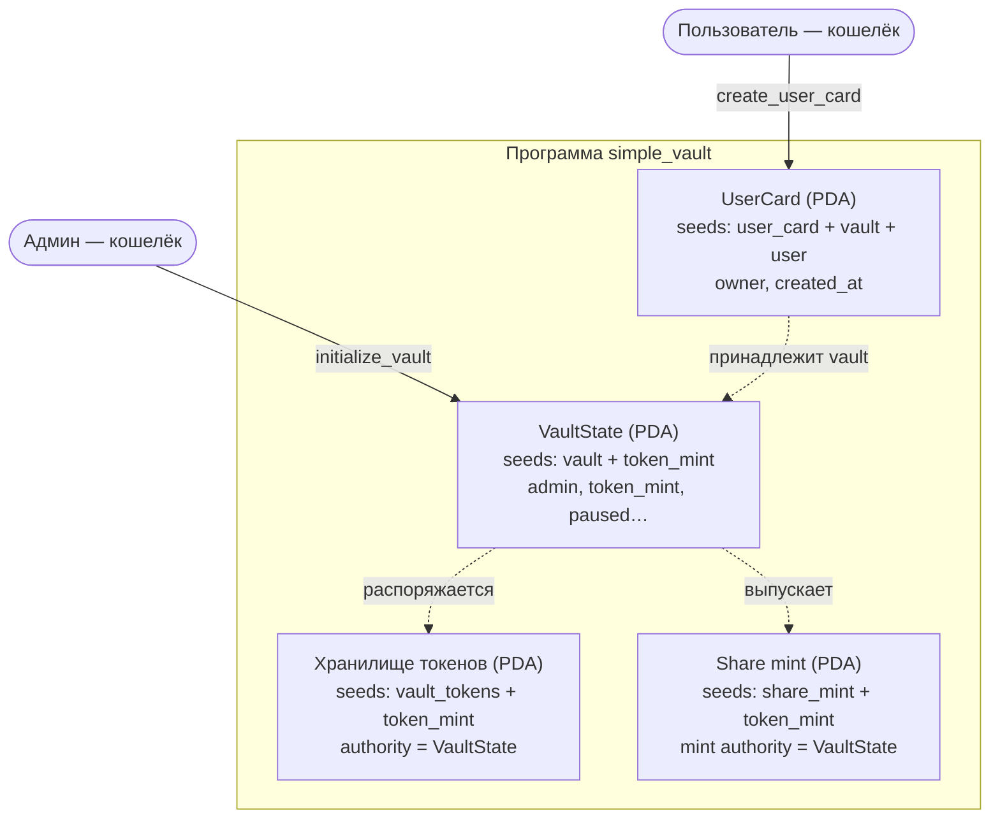

# Liquidity Vault (недели 8–15)

Учебный DeFi-vault на Anchor 0.31.1. Пользователи вносят токены в общее хранилище и получают
share-токены — квитанцию о своей доле. Основа — шаблон преподавателя
([0xnurda/vault-dev](https://github.com/0xnurda/vault-dev/tree/students-vault-card)).

**Program ID (devnet):** [`5KDkgHuq5VRs3jJcVGkFqNZYNBAvymVFnn6tDdABEUwp`](https://explorer.solana.com/address/5KDkgHuq5VRs3jJcVGkFqNZYNBAvymVFnn6tDdABEUwp?cluster=devnet)

| Неделя | Что сделано |
|---|---|
| 8 | Каркас: vault, share-токен, хранилище, карточка пользователя. Пауза vault, закрытие карточки, время создания |
| 9 | Депозит: перевод токенов в хранилище, выпуск share-токенов по курсу, учёт в vault и карточке |
| 10 | Вывод через CPI: сжигание share-токенов, возврат токенов с подписью vault PDA |
| 11 | Свой CLMM-пул Raydium в devnet (VLT / tUSD) и позиция в диапазоне ±10% |

Состояние проекта на конец каждой недели — по тегам: [week-08](https://github.com/LINESKL/solana-course/tree/week-08/vault),
[week-09](https://github.com/LINESKL/solana-course/tree/week-09/vault), [week-10](https://github.com/LINESKL/solana-course/tree/week-10/vault), [week-11](https://github.com/LINESKL/solana-course/tree/week-11/vault).

---

## Неделя 8 — каркас vault

### Схема аккаунтов



| Аккаунт | Seeds | Владелец аккаунта (owner) | Кто распоряжается | Что хранит |
|---|---|---|---|---|
| `VaultState` | `["vault", token_mint]` | программа vault | меняет только программа; `set_paused` — только админ | admin, token_mint, адреса хранилища и share mint, bump, paused |
| Хранилище токенов | `["vault_tokens", token_mint]` | Token Program | **VaultState (PDA)** — authority токен-аккаунта | внесённые токены |
| Share mint | `["share_mint", token_mint]` | Token Program | **VaultState (PDA)** — mint authority | share-токены (6 знаков) |
| `UserCard` | `["user_card", vault_state, user]` | программа vault | пользователь (закрыть может только он) | vault, owner, bump, created_at |

Главная идея: хранилищем и share-токеном распоряжается **VaultState — PDA без приватного ключа**.
Подписать за него может только сама программа, поэтому ни админ, ни кто-то ещё не может
забрать токены или напечатать share-токены своей подписью.

### Инструкции

| Инструкция | Кто вызывает | Что делает |
|---|---|---|
| `initialize_vault` | админ | один раз создаёт VaultState, хранилище и share mint для токена |
| `create_user_card` | пользователь | создаёт свою карточку; на паузе — ошибка `VaultPaused` |
| `close_user_card` | владелец карточки | закрывает карточку, рента возвращается владельцу |
| `set_paused(bool)` | только админ (`has_one = admin`) | ставит vault на паузу или снимает с неё |

### Аккаунты в devnet (vault недели 8)

| Что | Ссылка |
|---|---|
| Программа | [5KDk…EUwp](https://explorer.solana.com/address/5KDkgHuq5VRs3jJcVGkFqNZYNBAvymVFnn6tDdABEUwp?cluster=devnet) |
| VaultState | [2Gqx…182d](https://explorer.solana.com/address/2GqxhmtHQR6L8BUD5mw9WmT47GaSchWV7pMiyvAm182d?cluster=devnet) |
| Токен vault (тестовый) | [AETY…Mtd3](https://explorer.solana.com/address/AETYRLKneVCEquYyrzedpQDWspskm8J5dr41QEimMtd3?cluster=devnet) |
| Хранилище токенов | [8urM…SRqi](https://explorer.solana.com/address/8urMhJnqeut6ZNsF3ZQVHDEh9DiPTcZ2tGzGCjveSRqi?cluster=devnet) |
| Share mint | [6spV…TaUqx](https://explorer.solana.com/address/6spVDyGK2CAEUNDB2mNXVf23Zx2kaExQSvQMZnZTaUqx?cluster=devnet) |
| Карточка пользователя | [GMKe…grP](https://explorer.solana.com/address/GMKeqbfv2iHiUfaCCah3XE2N6cz2QJH84jWRzQMVsgrP?cluster=devnet) |
| Транзакция `initialize_vault` | [5tAw…LnNCb](https://explorer.solana.com/tx/5tAwCt8Wn7PXpovLeRLab9Km1PxR97qpSeiLSi8fDnnAhbkVMVRsQDomo6mzycN3PVHExe6FXpkYt2CaqqKLnNCb?cluster=devnet) |
| Транзакция `create_user_card` | [vEbr…5CNg](https://explorer.solana.com/tx/vEbrAmQUcDpywEAJDS7qW1GSobdeHRkdQNac36oRm9a9nmpLbCWRDNhD68cSEXhoSXH77i3qdgrDuYfvPae5CNg?cluster=devnet) |

Это vault из недели 8 (старая структура данных). Актуальный vault — в разделе недели 9 и в [`devnet.json`](devnet.json).

### Проверьте себя

- **Почему share-токен выпускает программа, а не администратор?** Mint authority share-токена —
  VaultState (PDA). Если бы выпускал админ, он мог бы напечатать себе share-токены и забрать
  чужую долю. Программа выпускает их только по правилам кода — при депозите.
- **Что такое PDA и почему у неё нет приватного ключа?** Адрес, вычисленный из seeds и ID
  программы так, что он специально не лежит на кривой Ed25519. Для такого адреса не существует
  приватного ключа, поэтому подписать за него может только программа (через `invoke_signed`).
- **Как найти карточку конкретного пользователя?** Вычислить адрес из seeds
  `["user_card", vault_state, user]` — хранить список пользователей не нужно.

---

## Неделя 9 — депозит и share-токены

`deposit(amount)` — пользователь вносит токены и получает share-токены (свою долю):

1. **считает долю:** первый вкладчик получает share-токены 1:1, дальше
   `shares = amount × всего_shares / всего_токенов_в_vault` (в u128, округление вниз — в пользу vault);
2. **переводит токены пользователя в хранилище** — CPI `transfer_checked` в Token Program, подписывает сам пользователь;
3. **выпускает share-токены** — CPI `mint_to`, подписывает программа от имени VaultState (PDA, `invoke_signed` с seeds `["vault", token_mint, bump]`);
4. **обновляет учёт:** `VaultState.total_deposited` и `UserCard.deposited`.

Ограничения: сумма > 0 (`ZeroAmount`), за депозит должно быть положено хотя бы 1 share (`ZeroShares`),
нужна своя карточка, токены только со своего токен-аккаунта, на паузе депозит запрещён.
Токен-аккаунт для share-токенов создаётся автоматически при первом депозите (`init_if_needed`).

**Пример из методички проверен тестом:** в vault 1000 токенов и 1000 shares, vault заработал +100
(стало 1100), новый пользователь вносит 110 → получает 100 shares (110 / 1100 × 1000).

### Депозит в devnet

После обновления программы структура `VaultState` изменилась (добавлено `total_deposited`), поэтому
для недели 9 создан новый vault (адреса в [`devnet.json`](devnet.json)):

| Что | Ссылка |
|---|---|
| VaultState | [3xsM…mmb6](https://explorer.solana.com/address/3xsMsffXc69QVhNxhv5g7YFBPXpTFj6cApaty12vmmb6?cluster=devnet) |
| Токен vault | [Fmke…gUBx](https://explorer.solana.com/address/Fmke9hR8YLR127as4pPpPx4DLQgt1Pjh5rAqTWHzgUBx?cluster=devnet) |
| Хранилище | [61ti…bRrh](https://explorer.solana.com/address/61tivhpQ89oxZodpQMo2XN7mXCQ7bcGxWEAFeTyebRrh?cluster=devnet) |
| Share mint | [G24j…qRNU](https://explorer.solana.com/address/G24jyuWdDXv51veZJTzut3WSajCaVrpme98DCUWuqRNU?cluster=devnet) |
| **Транзакция депозита 1000 токенов** | [9ffV…bXmu](https://explorer.solana.com/tx/9ffVkDtu1nNerFJk4iMnG591ZhY9ryoXtoVpKWZ4HgHkghNYR3t6ParsRnesKvLRK3jxSMUzCAoF4vPurPebXmu?cluster=devnet) |

Что внутри транзакции депозита (вызовы между программами):

```
simple_vault · Deposit
├─ Associated Token Program · create          — токен-аккаунт для share-токенов (первый депозит)
│  ├─ Token Program · getAccountDataSize
│  ├─ System Program · createAccount
│  ├─ Token Program · initializeImmutableOwner
│  └─ Token Program · initializeAccount3
├─ Token Program · transferChecked  1000 → хранилище vault   (подпись пользователя)
└─ Token Program · mintTo           1000 shares → пользователю (подпись vault PDA)
```

### Проверьте себя

- **Почему поздний вкладчик может получить share-токенов меньше, чем внёс токенов?** Share — это доля.
  Если vault заработал, на каждый share приходится больше токенов, и share «стоит» дороже. Иначе
  новичок забрал бы часть дохода тех, кто вложился раньше.
- **Почему перевод подписывает пользователь, а выпуск share-токенов — программа?** Переводятся токены
  пользователя — разрешить это может только он. А mint authority share-токена — PDA vault, у неё нет
  ключа, поэтому подписывает программа через seeds.
- **Какие программы участвовали в транзакции?** simple_vault, Token Program, Associated Token Program,
  System Program (см. дерево выше).

---

## Неделя 10 — CPI и вывод

**CPI (Cross-Program Invocation)** — вызов одной программы из другой. Сама программа vault токены
двигать не умеет, это делает Token Program, поэтому vault вызывает её. Бывает два вида подписи:

| Что двигаем | Кто подписывает | Как в коде |
|---|---|---|
| Токены пользователя (депозит, сжигание shares) | пользователь — его подпись передаётся дальше по цепочке | `CpiContext::new(...)` |
| Токены vault (выпуск shares, вывод из хранилища) | программа от имени VaultState (PDA) | `CpiContext::new_with_signer(..., seeds)` |

`withdraw(shares)`:

1. проверяет, что shares > 0 и у пользователя их достаточно (`ZeroAmount`, `InsufficientShares`);
2. считает долю: `amount = shares × всего_токенов_в_vault / всего_shares`;
3. **CPI `burn`** — сжигает share-токены пользователя (подпись пользователя);
4. **CPI `transfer_checked`** — переводит токены из хранилища пользователю (подпись vault PDA через seeds `["vault", token_mint, bump]`);
5. уменьшает `deposited` в карточке и `total_deposited` в vault пропорционально выведенной доле.

Вывод разрешён и на паузе: выйти из vault пользователь может всегда. Карточку с внесёнными
средствами закрыть нельзя (`CardNotEmpty`).

### Вывод в devnet

[Транзакция вывода 400 share-токенов](https://explorer.solana.com/tx/67XtgY5iFjfVsa3GR2fTDdEPEEJm9rBScgYtgQBH83QCqTaifv4jsiLehatWWHb3rphFHedUfAfVvuC9hSC3WVQP?cluster=devnet):
в vault было 1000 токенов и 1000 shares, пользователь вернул 400 shares и получил 400 токенов.

**CPI-вызовы в этой транзакции** (в Explorer — блок *Inner Instructions*):

```
simple_vault · Withdraw                                  invoke [1]
├─ Token Program · burn            400 shares            invoke [2]  подпись пользователя
└─ Token Program · transferChecked 400 токенов → user    invoke [2]  подпись vault PDA
```

`invoke [2]` в логах — это вызов второго уровня, то есть CPI из нашей программы.

### Проверьте себя

- **Что такое CPI и зачем он нужен?** Вызов одной программы из другой. Не нужно писать всё с нуля:
  токены двигает Token Program, а дальше vault так же будет вызывать биржу Raydium.
- **Когда подписывает пользователь, а когда программа?** Пользователь — когда двигаются его токены
  (перевод в vault, сжигание его shares). Программа от имени PDA — когда двигаются токены vault
  (выпуск shares, выдача токенов из хранилища).
- **Почему администратор не может просто забрать токены из vault своей подписью?** Authority хранилища —
  VaultState (PDA), а не админ. Подписать за PDA может только программа, а в программе нет
  инструкции, которая отдала бы токены админу.

---

## Неделя 11 — AMM и концентрированная ликвидность

**AMM** — биржа без книги заявок: в пуле лежат два токена, цену задаёт формула. В простом пуле
`x × y = k`, и ликвидность «размазана» по всем ценам от 0 до бесконечности. В **CLMM**
(concentrated liquidity) провайдер выбирает диапазон цен, в котором работают его деньги: пока цена
внутри — позиция участвует в обменах и получает комиссии, вышла за диапазон — перестаёт.
Цены разбиты на шаги — **тики**, позиция в Raydium оформляется как **NFT**.

Пул собран скриптами в [`raydium/`](raydium) на официальном SDK Raydium (по образцу
`raydium-io/raydium-sdk-V2-demo`, раздел clmm):

```bash
cd raydium && npm install
node create-tokens.mts    # второй токен tUSD + пополнение обоих токенов
node create-pool.mts      # CLMM-пул с начальной ценой 1 VLT = 2 tUSD, комиссия 0.25%
node open-position.mts    # позиция ±10% вокруг текущей цены (RANGE=10 AMOUNT=10000)
node pool-info.mts        # цена, ликвидность, позиции
```

### Адреса в devnet

| Что | Адрес |
|---|---|
| Токен vault — **VLT** | [Fmke…gUBx](https://explorer.solana.com/address/Fmke9hR8YLR127as4pPpPx4DLQgt1Pjh5rAqTWHzgUBx?cluster=devnet) (тот же, что принимает vault) |
| Второй токен — **tUSD** | [4Nqn…RubZ4](https://explorer.solana.com/address/4NqnPuNnGra15G4RfjoahuTuTcNzN2C33wLobSjRubZ4?cluster=devnet) |
| Программа Raydium CLMM (devnet) | [DRay…9pfH](https://explorer.solana.com/address/DRayAUgENGQBKVaX8owNhgzkEDyoHTGVEGHVJT1E9pfH?cluster=devnet) |
| **Пул VLT / tUSD** | [7pSV…Aj8p](https://explorer.solana.com/address/7pSVsGQ3wvc6rLFgraye6Y6LqrFcr43f5wD3gCHiAj8p?cluster=devnet) |
| Конфиг пула (комиссия 0.25%, шаг тиков 60) | [CD4a…Q1qu](https://explorer.solana.com/address/CD4aJtX11cqTCAc83nxSPkkh5JW2yjD6uwHeovjqQ1qu?cluster=devnet) |
| **NFT позиции** | [GAia…EvMh9](https://explorer.solana.com/address/GAiadcKH2kUTvkvpL8iWWUYCiYQHw4ifDUr2GgfEvMh9?cluster=devnet) |
| Создание пула | [транзакция](https://explorer.solana.com/tx/vHDGGNdL41fEyUCwdFbYtZvTQao28oBxUxU273pp5uzdq5QuCw9aPAQfumoBfqEB1DUHeaJeSbShw8joihmVCvT?cluster=devnet) |
| Открытие позиции | [транзакция](https://explorer.solana.com/tx/5DkaVWpJVmuCxRQtDMC7YXk9QJEMSj5PYEXuzY4u6RKSqXAYMX3TDmq8jReU8rYhFmXPvcd1foJh5w3Ty7ECR4Lw?cluster=devnet) |

Все адреса пула (vault-аккаунты, observation, bitmap) — в [`raydium.json`](raydium.json), они нужны для CPI на неделях 12–13.

### Цена и диапазон

Raydium упорядочивает токены пула по адресу, поэтому в пуле **токен A — tUSD, токен B — VLT**,
и цена записана как «VLT за 1 tUSD».

| | |
|---|---|
| Текущая цена | **0.5 VLT за 1 tUSD** = 2 tUSD за 1 VLT (тик −6932) |
| Диапазон позиции | **0.4476 … 0.5488 VLT за tUSD** (тики −8040 … −6000) ≈ −10.5% / +9.8% |
| В позиции | 10 000 tUSD + 5 920.4 VLT |

**Почему такой диапазон.** Взял ±10% от текущей цены — правило из методички: отступить на
величину обычного колебания цены. Уже ±1–2% дал бы больше комиссий с тех же денег, но цена
быстро вышла бы за границы, и позицию пришлось бы постоянно переставлять. Широкий (±50% и больше)
спокойнее, но почти не отличается от простого пула по доходу. ±10% — середина: обмены на неделях
12–13 не выбьют цену из диапазона, а ликвидность сосредоточена рядом с ценой. Границы чуть
несимметричны, потому что подгоняются к шагу тиков (60).

### Найденная проблема SDK

`raydium.clmm.getPoolInfoFromRpc` в SDK 0.2.74 падает на **новом пуле без ликвидности**
(`Cannot convert undefined or null to object`): внутри `Object.values(tickData[poolId])`, а у пустого
пула ещё нет tick-массивов. Из-за этого нельзя открыть первую позицию. Исправлено в
[`raydium/common.mts`](raydium/common.mts) — для пулов без tick-массивов подставляются пустые данные.

### Проверьте себя

- **Чем концентрированная ликвидность отличается от простого пула?** В простом пуле деньги
  распределены по всем ценам, и почти все лежат без дела. В CLMM провайдер сам выбирает диапазон,
  и все его деньги работают только там — с той же суммы получается больше комиссий.
- **Что происходит с позицией, когда цена выходит за её диапазон?** Она перестаёт участвовать в
  обменах и зарабатывать. Вся позиция превращается в один токен: выше верхней границы — в токен B,
  ниже нижней — в токен A. Доход вернётся, только если цена вернётся или диапазон переставят.
- **Почему узкий диапазон зарабатывает больше, но требует больше внимания?** Та же сумма
  распределена по меньшему числу тиков, поэтому на каждый обмен приходится большая доля комиссий.
  Но цена чаще выходит из узкого диапазона, и его надо чаще переставлять (ребалансировка).

---

## Запуск

Нужны: Rust, Solana CLI, **Anchor CLI 0.31.1**, Node.js 18+.

```bash
npm install                     # или yarn install
anchor build

# тесты на локальном валидаторе
anchor test --provider.cluster localnet

# тесты на devnet (программа уже задеплоена)
anchor test --provider.cluster devnet --skip-local-validator --skip-deploy

# деплой
anchor deploy --provider.cluster devnet

# vault в devnet из терминала
node scripts/devnet.mts init    # тестовый токен + vault
node scripts/devnet.mts card    # своя карточка
node scripts/devnet.mts mint 5000      # начислить себе тестовые токены
node scripts/devnet.mts deposit 1000   # депозит
node scripts/devnet.mts withdraw 400   # вывод (сколько share-токенов вернуть)
node scripts/devnet.mts show    # состояние и ссылки на Explorer
```

Кошелёк берётся из `~/.config/solana/id.json`. Ключи и seed-фразы в репозиторий не коммитятся
(см. `.gitignore`).

Если локальный валидатор не стартует с ошибкой `UnspecifiedIpAddr(0.0.0.0)` (новые версии
Solana CLI), в `Anchor.toml` в `[test.validator]` нужен `bind_address = "127.0.0.1"` — уже добавлен.
